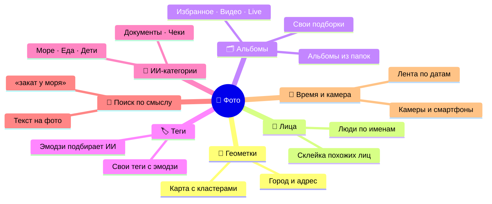
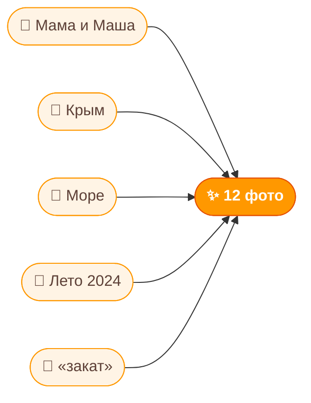
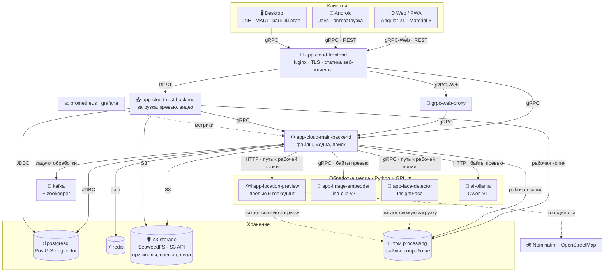
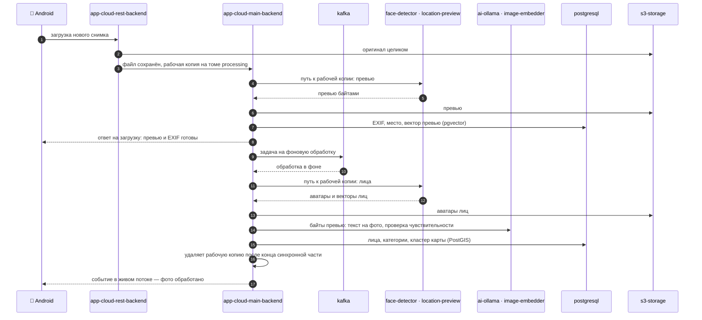

  

<h3 align="center">Личное облако для фото и видео с ИИ, который помнит каждый кадр</h3>

  Снимки с телефона загружаются сами. Сервер находит лица, места, текст и смысл кадра. 
  Нужное фото находится за пару касаний — в браузере и на Android.

  
  
  
  
  
   
  
  
  
  
  
  

  <a href="#-как-найти-любое-фото">Возможности</a> ·
  <a href="#architecture">Архитектура</a> ·
  <a href="#photo-pipeline">Обработка фото</a> ·
  <a href="#-инженерные-решения">Инженерные решения</a> ·
  <a href="#-репозитории">Репозитории</a>

---

## 🌟 Коротко

**SmartCloud** — self-hosted фототека полного цикла. Сервер, обработка фото и ИИ-модели работают на своём железе, поэтому снимки не уходят в чужое облако.

<table>
<tr>
<td width="33%" valign="top">

**📲 Загрузка без участия** 
Android-клиент сам отправляет новые снимки на сервер. Live-фото сохраняются вместе с видеофрагментом.

</td>
<td width="33%" valign="top">

**🧠 Понимание кадра** 
Лица, место съёмки, текст на фото, ИИ-категория и смысловой вектор появляются у фото сразу после загрузки.

</td>
<td width="33%" valign="top">

**🔐 Своё — у себя** 
Модели работают локально на GPU. Чувствительные снимки скрываются автоматически. Делиться можно отдельной ссылкой.

</td>
</tr>
</table>

---

## 🔍 Как найти любое фото

У каждого снимка есть несколько признаков: место, люди, альбомы, теги и ИИ-категории. Фильтр можно открыть по любому из них, а потом сузить выборку другими.

<table>
<tr>
<td width="50%" valign="top">

### 📍 Геометки и карта

Все снимки с GPS показаны на карте. Близкие точки собираются в кластеры с превью и счётчиком. Сервер заранее считает кластеры для 15 уровней масштаба, поэтому карта с тысячами фото открывается сразу.

Фото без GPS получают координаты от соседнего снимка, сделанного в то же время. Для каждой точки сервис геокодинга подставляет город и адрес.

</td>
<td width="50%" valign="top">

### 👤 Лица

ИИ находит лица на каждом снимке и собирает фото одного человека в группу. Группе можно дать имя, а потом искать фото по нему.

Похожие группы приложение предлагает объединить или склеивает само. Лишнее лицо можно убрать из группы, а случайного прохожего — скрыть.

</td>
</tr>
<tr>
<td width="50%" valign="top">

### 🗂️ Альбомы

- **Свои альбомы** — подборки из выбранных фото.
- **Альбомы из папок** сами пополняются, когда в папке появляется новый снимок.
- **Системные альбомы**: избранное, фото, видео, Live-фото и снимки с каждой камеры с логотипом бренда.

</td>
<td width="50%" valign="top">

### 🏷️ Теги

Свой тег ставится на любое фото: «Отпуск 2025», «Дача», «Свадьба Маши». При создании тега ИИ предлагает к нему подходящий эмодзи 🏖️ 🏡 💍. Тег работает как фильтр и как отдельный альбом.

</td>
</tr>
<tr>
<td width="50%" valign="top">

### 🤖 ИИ-категории

Каждое фото получает категорию без участия пользователя:

`🌊 Море` `🌳 Парки` `🍕 Еда` `🐾 Животные` `👶 Дети` `🖍️ Детский рисунок` `🎉 Праздник` `🚗 Транспорт` `💻 Техника` `👗 Одежда` `🖼️ Картина` `📄 Документы` `🧾 Чеки` `🛂 Паспорт` `▦ Штрихкоды`

Чеки и сканы документов больше не теряются среди снимков из отпуска.

</td>
<td width="50%" valign="top">

### 🔎 Поиск по смыслу

Запрос «закат у моря», «собака на снегу» или «торт со свечами» находит нужные кадры, даже если у фото нет подписей. Запрос можно писать на любом языке.

Поиск учитывает и текст на самих фото: вывески, чеки, страницы документов.

</td>
</tr>
</table>

### 🧩 Фильтры складываются

Любые признаки комбинируются в один запрос. Рядом с каждым вариантом показано, сколько фото останется после его выбора, поэтому пустых выборок не бывает.

- **«Любой из»** — фото, где есть Мама *или* Маша.
- **«Все сразу»** — только кадры, где Мама и Маша вместе. Так же работают теги и ИИ-категории.
- Фильтр по альбому, папке, камере, избранному, видео и Live-фото.
- Отфильтрованную подборку можно сразу посмотреть на карте.

### 🎁 И ещё

| Возможность | Как работает |
| --- | --- |
| 👁️ **Скрытие чувствительного** | ИИ отмечает откровенные снимки и прячет их из ленты. Отметку можно поставить или снять вручную. |
| 🔗 **Доступ по ссылке** | Альбом или подборку можно отправить родным, им не нужен аккаунт. |
| 🧹 **Поиск дубликатов** | Приложение находит одинаковые файлы по всей фототеке и помогает удалить лишнее. |
| ♻️ **Корзина** | Удалённые папки восстанавливаются целиком, конфликты имён разбираются заранее. |
| ⚡ **Живые обновления** | Новое фото, найденное лицо или созданный альбом сразу появляются на всех открытых устройствах. |
| 📱 **Web и Android** | Один интерфейс в браузере, в установленном PWA и на телефоне. |

---

## 🏗️ Архитектура

Микросервисы на Java/Groovy и Python, общий gRPC-контракт для всех клиентов, одна база PostgreSQL с гео-индексами и векторами и S3-хранилище для файлов. Общего тома между контейнерами нет.

> [!NOTE]
> **`app-cloud-main-backend` планируется декомпозировать на микросервисы.** Сейчас в нём собраны файлы, медиа, лица, альбомы, теги и поиск. Эти домены будут вынесены в отдельные сервисы с собственными gRPC-контрактами.

## 🎞️ Путь одной фотографии

## 💡 Инженерные решения

| Решение | Зачем |
| --- | --- |
| **Contract-first gRPC** | Один набор `.proto` порождает код для Java-сервера, TypeScript-клиента (gRPC-Web) и Android. Галереи, лента и события приходят server-streaming'ом, поэтому экран рисуется по мере получения данных. |
| **Одна база вместо трёх** | PostgreSQL + PostGIS + pgvector: гео-запросы, поиск ближайших векторов и фасеты с подсчётом выполняются одним SQL. Отдельные поисковый движок и векторная БД не нужны. |
| **Объектное хранилище** | Файлы лежат в S3 (SeaweedFS) под ключами `{userId}/ORIGINAL/{fileId}`; имена и дерево папок живут только в БД, поэтому переименование и перенос мгновенны. Свежая загрузка до конца обработки лежит рабочей копией на томе `processing`: обработчики читают её с диска, а не скачивают из S3, последний обработчик её удаляет. |
| **Асинхронный конвейер** | Загрузка отвечает сразу, тяжёлая обработка идёт через Kafka. Пересчёт старых фото (новые векторы, перестроение карты) ставится в очередь фоновых задач. |
| **Мультиязычный CLIP** | `jina-clip-v2` переводит фото и текст запроса в одно векторное пространство. Запрос на русском находит кадр без машинного перевода. |
| **Предрасчитанная карта** | Кластеры для 15 уровней масштаба готовятся заранее, карта не считает их на лету. |
| **Локальный ИИ** | Все модели — на своём GPU. Есть профили под 8 и 16 ГБ VRAM. |
| **Одинаковый UX** | Web и Android держат одни тексты, порядок элементов и переходы. Различаются только платформенные жесты и диалоги. |
| **Надёжность** | Миграции Liquibase, интеграционные тесты на Testcontainers, роли и JWT в gRPC, TLS на входе, метрики в Prometheus и Grafana. |

### 🧠 Модели

| Модель | Что делает | Где работает |
| --- | --- | --- |
| [InsightFace buffalo_l](https://pypi.org/project/insightface/0.7.3/) | Находит лица и сравнивает их | CPU |
| [jina-clip-v2](https://huggingface.co/jinaai/jina-clip-v2) | Векторы фото и запросов для поиска по смыслу | NVIDIA GPU, ≈1,8 ГБ VRAM |
| [Qwen2.5-VL 3B Instruct Q4_K_M](https://huggingface.co/ggml-org/Qwen2.5-VL-3B-Instruct-GGUF) | Читает текст на фото и определяет чувствительный контент | 8 ГБ VRAM, например RTX 3070 Ti |
| [Qwen3-VL 8B Instruct Q4_K_M](https://huggingface.co/Qwen/Qwen3-VL-8B-Instruct-GGUF) | То же, точнее | 16 ГБ VRAM, например RTX 5070 Ti |

## 📦 Репозитории

| Репозиторий | Назначение | Стек |
| --- | --- | --- |
| [SmartCloud-Backend-apps](https://github.com/Bati4eli/SmartCloud-Backend-apps) | Сервер, обработка медиа, развёртывание | Java 25, Groovy, Spring Boot, Python, gRPC, Kafka, PostgreSQL |
| [SmartCloud-Frontend](https://github.com/Bati4eli/SmartCloud-Frontend) | Веб-клиент, устанавливается как PWA | Angular 21, Material 3, gRPC-Web, Leaflet |
| [SmartCloud-Android](https://github.com/Bati4eli/SmartCloud-Android) | Android-клиент с автозагрузкой | Java, gRPC |
| [SmartCloud-Desktop-MAUI](https://github.com/Bati4eli/SmartCloud-Desktop-MAUI) | Кроссплатформенный клиент, ранний этап | .NET MAUI, gRPC |

Как собрать и запустить каждую часть, описано в README репозиториев: [backend](https://github.com/Bati4eli/SmartCloud-Backend-apps#readme), [web](https://github.com/Bati4eli/SmartCloud-Frontend#readme), [Android](https://github.com/Bati4eli/SmartCloud-Android#readme).

---

   
  Проект спроектирован и написан <a href="https://github.com/Bati4eli">@Bati4eli</a> — от схемы базы до Android-клиента. 

